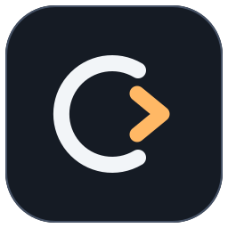

<p align="center">
  
</p>

<h1 align="center">Codey</h1>

<p align="center">An extensible terminal coding agent built on Pi.</p>

Codey is a fork of [Pi](https://github.com/earendil-works/pi) for working on code from the terminal. Start it in a project directory to explore files, make edits, run commands, and return to saved sessions.

This repository is in early development. Its independent `codey` launcher runs this checkout's Pi CLI and defaults to `~/.codey/agent` for user settings and sessions. Root and authentication help display Codey; the internal runtime, interactive interface and OAuth identity remain Pi. Existing `pi` commands and project `.pi` directories retain their behavior. Existing user data is not automatically imported.

## Install Codey

On macOS or Linux, install a reviewed commit using the [Codey installer](codey/README.md). It requires Git, npm and Node.js 22.19 or newer, installs into your home directory without sudo, and adds `codey` to your shell's PATH. It does not install anything globally through npm. The upstream Pi installer does not install Codey.

## Run from source

You need Git and Node.js 22.19 or newer. On macOS or Linux:

```bash
git clone https://github.com/yaoshining/codey.git
cd codey
npm ci --ignore-scripts
node codey/hydrate-model-data.mjs
./codey/bin/codey --help
```

To work on another project, launch from that project's directory:

```bash
cd /path/to/project
/path/to/codey/codey/bin/codey
```

The Codey launcher currently supports macOS and Linux. On Windows, the existing `pi-test.ps1` remains available. Inside the interactive session, run `/login` to set up a supported provider, or follow the [provider setup guide](packages/coding-agent/docs/providers.md).

## Extend or automate it

These capabilities come from Pi:

- Add custom tools and commands with [TypeScript extensions](packages/coding-agent/docs/extensions.md). Add reusable workflows with [skills](packages/coding-agent/docs/skills.md) and [prompt templates](packages/coding-agent/docs/prompt-templates.md).
- Use [print or JSON mode](packages/coding-agent/docs/cli.md) for scripts, [RPC](packages/coding-agent/docs/rpc.md) from another process, or the [TypeScript SDK](packages/coding-agent/docs/sdk.md) to embed the agent.

The agent runs with the permissions of the process that starts it. See the [isolation guide](packages/coding-agent/docs/containerization.md) for options to restrict filesystem, process, and network access.

## Upstream and license

Codey is based on [Pi by Mario Zechner and the Pi contributors](https://github.com/earendil-works/pi). The [upstream documentation](https://pi.dev/docs/latest) covers inherited behavior. The source is available under the [MIT license](LICENSE).
